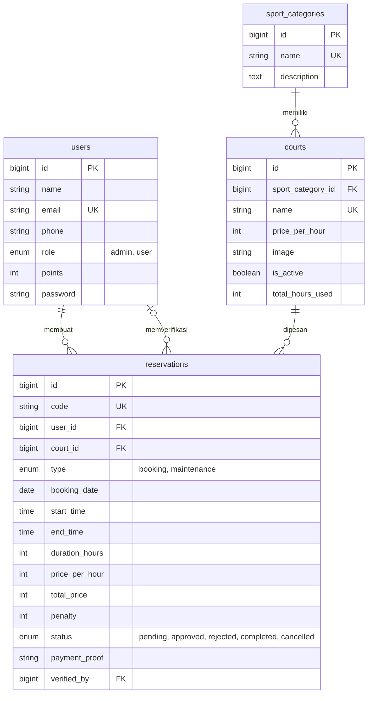

# ArenaKu: Sistem Reservasi Lapangan Olahraga (Futsal / Padel)

Aplikasi web Laravel 12 dengan dua role (Admin dan User), kalkulasi tarif otomatis,
pengecekan bentrok jadwal, dan transaksi database atomik. Tampilan memakai Bootstrap 5 (CDN),
jadi tidak perlu `npm install`.

## Skema Relasi Tabel



| Relasi | Eloquent |
|---|---|
| User → Reservation | `hasMany` / `belongsTo` |
| SportCategory → Court | `hasMany` / `belongsTo` |
| Court → Reservation | `hasMany` / `belongsTo` |
| Reservation → User (verifikator) | `belongsTo` lewat `verified_by` |
| User → Reservation (yang diverifikasi) | `hasMany` lewat `verified_by` (`verifiedReservations`) |

## Instalasi

Kebutuhan: PHP 8.2+, Composer, dan SQLite atau MySQL/MariaDB.

```bash
git clone <url-repository>
cd <nama-folder>
composer install
cp .env.example .env          # Windows PowerShell/CMD: copy .env.example .env
php artisan key:generate
```

`.env.example` sudah diatur untuk MySQL. Untuk XAMPP/Laragon, buat dulu database `reservasi_lapangan` (collation `utf8mb4_unicode_ci`), lalu pastikan `.env` berisi:

```env
DB_CONNECTION=mysql
DB_HOST=127.0.0.1
DB_PORT=3306
DB_DATABASE=reservasi_lapangan
DB_USERNAME=root
DB_PASSWORD=
```

Jika ingin memakai SQLite, ganti menjadi `DB_CONNECTION=sqlite` (jawab *yes* jika diminta membuat file database).

```bash
php artisan migrate --seed
php artisan storage:link
php artisan serve
```

Buka http://127.0.0.1:8000

## Akun Demo

| Role | Email | Password |
|---|---|---|
| Admin | admin | 123 |
| User | user1 | 321 |
| User | user2 | 231 |

## Aturan Bisnis

- Jam operasional 07.00 - 23.00, sewa per jam penuh, maksimal 5 jam per pesanan, paling jauh 30 hari ke depan.
- Bentrok jika `mulai_lama < selesai_baru` dan `selesai_lama > mulai_baru` pada lapangan dan tanggal yang sama.
  Status Pending, Approved, Completed, serta jadwal perawatan mengunci slot.
- Total biaya = (jam selesai - jam mulai) x tarif per jam, dihitung di server.
- User hanya bisa mengubah atau membatalkan pesanan berstatus Pending.
- Alur status: `Pending → Approved → Completed`, `Pending → Rejected`, `Pending → Cancelled`.
- Denda kelebihan main dihitung di server: jam kelebihan x tarif per jam. Admin hanya mengisi jumlah jam.
- Saat Completed, user mendapat 1 poin per jam dan jam pakai lapangan bertambah.

## Alur Transaksi (`DB::transaction`)

Semua perubahan data reservasi lewat `app/Services/ReservationService.php`. Baris lapangan dikunci
(`lockForUpdate`) sebelum cek bentrok, sehingga dua orang tidak bisa memesan slot yang sama bersamaan.

| Proses | Tabel yang berubah | Pengaman |
|---|---|---|
| Buat reservasi | `reservations` | Validasi jam, durasi, lapangan aktif, bentrok; tarif dihitung server |
| Ubah / batalkan | `reservations` (+ file bukti) | Hanya pemilik dan hanya status Pending |
| Setujui | `reservations` | Bukti transfer ada, jadwal belum lewat, tidak bentrok |
| Tolak | `reservations` | Alasan wajib diisi |
| Selesaikan | `reservations`, `users` (poin), `courts` (jam terpakai) | 3 tabel diubah atomik; hanya status Approved dan jadwal sudah dimulai |
| Blokir perawatan | `reservations` (type `maintenance`) | Tidak boleh menimpa pesanan yang sudah ada |

## Kesesuaian dengan Topik No. 2 (Reservasi Lapangan Padel)

| Ketentuan topik | Implementasi |
|---|---|
| Cek bentrok slot jam pada lapangan yang dipilih | `ReservationService::hasConflict` |
| Tarif otomatis dari selisih jam sewa | `prepareSchedule`: `(jam_selesai - jam_mulai) x tarif_per_jam` |
| User membatalkan selama Pending | `ReservationService::cancel` |
| Admin memverifikasi bukti transfer | `approve` dan `reject` (butuh bukti transfer) |
| Admin memblokir jadwal perawatan | `blockMaintenance` (menu Perawatan) |

## Peta Ketentuan Tugas ke Kode

| Ketentuan | Lokasi |
|---|---|
| Migration dan seeder | `database/migrations`, `database/seeders/DatabaseSeeder.php` |
| Auth manual dan role | `AuthController`, `RoleMiddleware`, `routes/web.php` |
| Ownership check | `User/ReservationController::authorizeOwner`, `ReservationRequest::authorize` |
| Kalkulasi, cek bentrok, `DB::transaction` | `app/Services/ReservationService.php` |
| Upload dan hapus file lama | `Admin/CourtController`, `ReservationService::update`, event `deleted` di model |
| Pencarian, filter, pagination | halaman katalog, riwayat, kategori, lapangan, reservasi |
| Dashboard statistik | `Admin/DashboardController`, `User/DashboardController` |

## Pengujian

```bash
php artisan test
```

Tes berjalan di SQLite memori (lihat `phpunit.xml`), jadi data MySQL aman. Berkas tes:

- `tests/Feature/ReservasiTest.php`: tarif, bentrok, perawatan, ownership, role, file lama, alur sampai Completed.
- `tests/Feature/LogikaBisnisTest.php`: relasi Eloquent, aturan jadwal, lapangan nonaktif, pembatalan, penolakan,
  penyelesaian tidak valid, perawatan, pencarian/filter, dan pagination.
